# Luna v2 screen gallery

These previews were rendered at 1280 x 750 from [`Luna_v2_Screens.pdf`](Luna_v2_Screens.pdf).

| Home and navigation | Gallery and files |
|---|---|
| **Home** 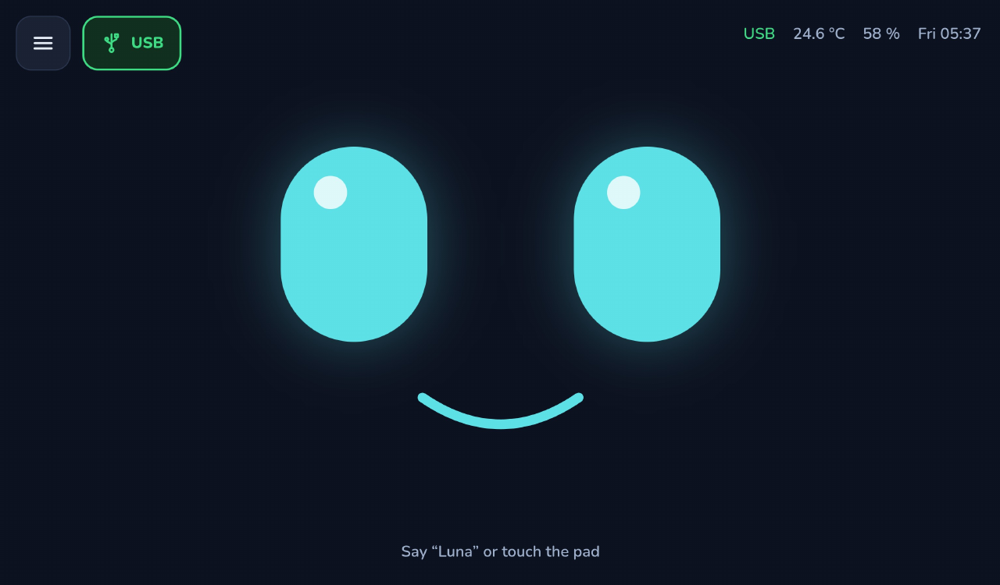 | **Menu** 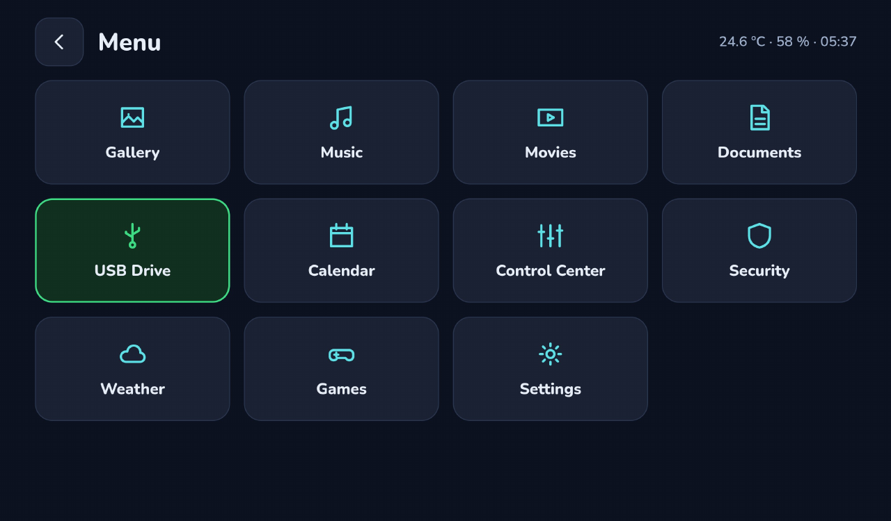 |
| **Hidden gallery PIN** 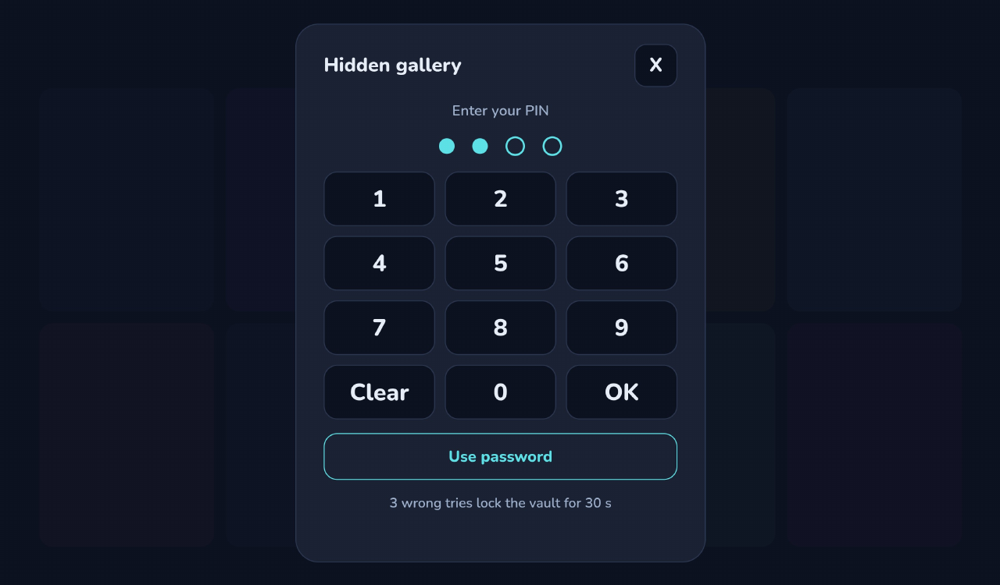 | **Gallery** 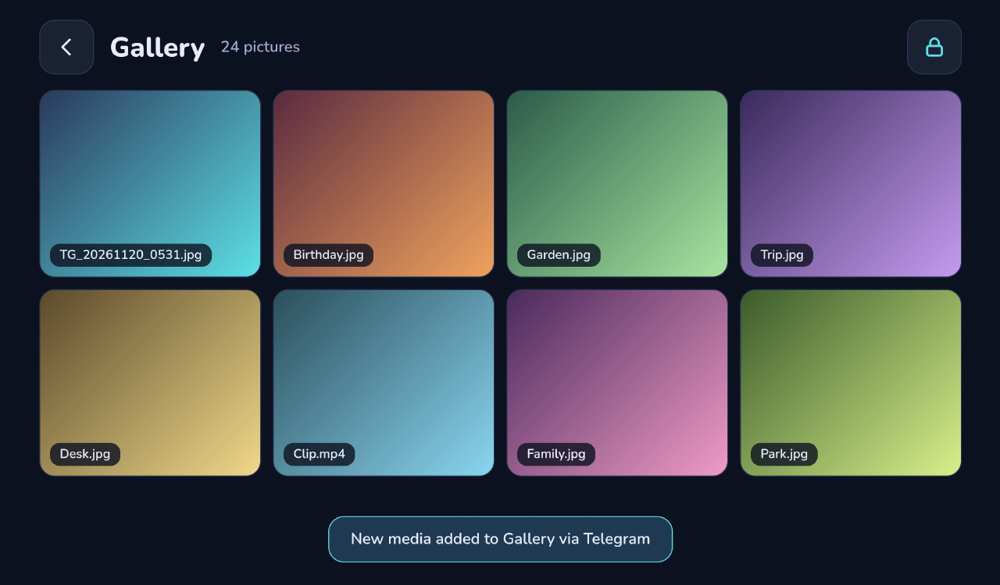 |
| **USB drive** 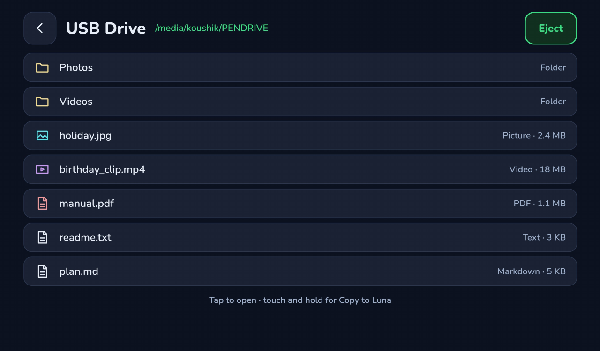 | **Document reader** 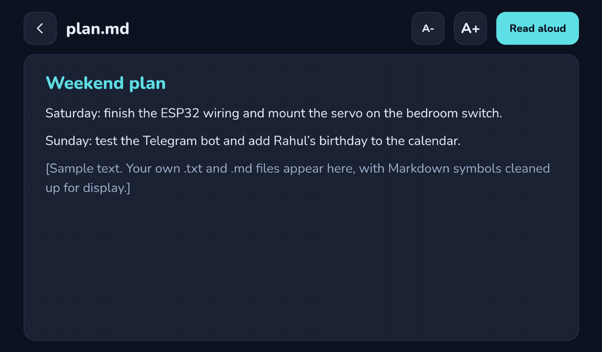 |

| Calendar | ESP32 control |
|---|---|
| **Calendar** 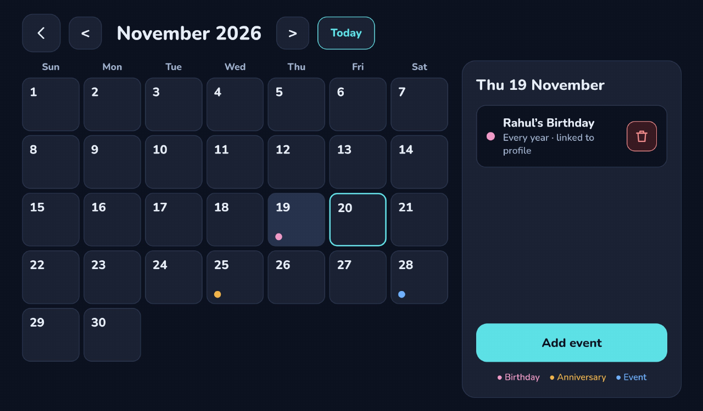 | **Add event** 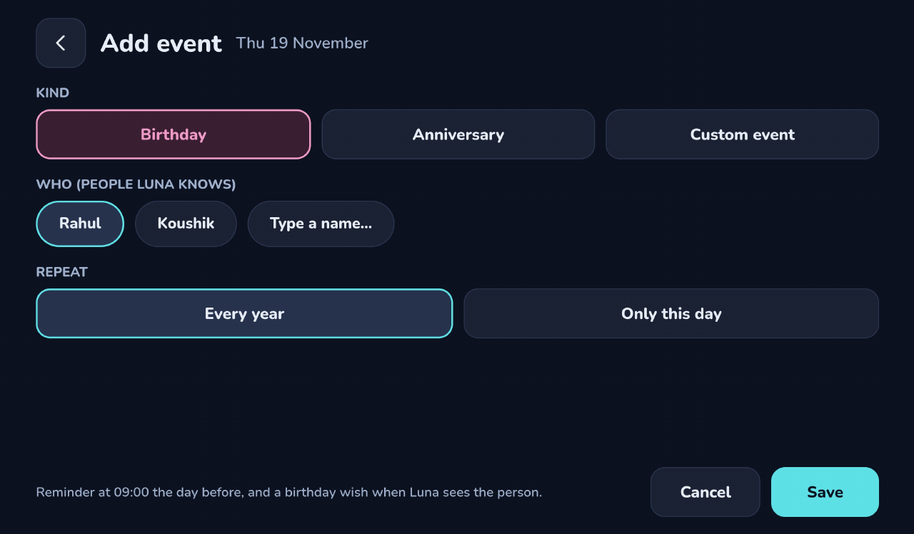 |
| **Control Center: nodes** 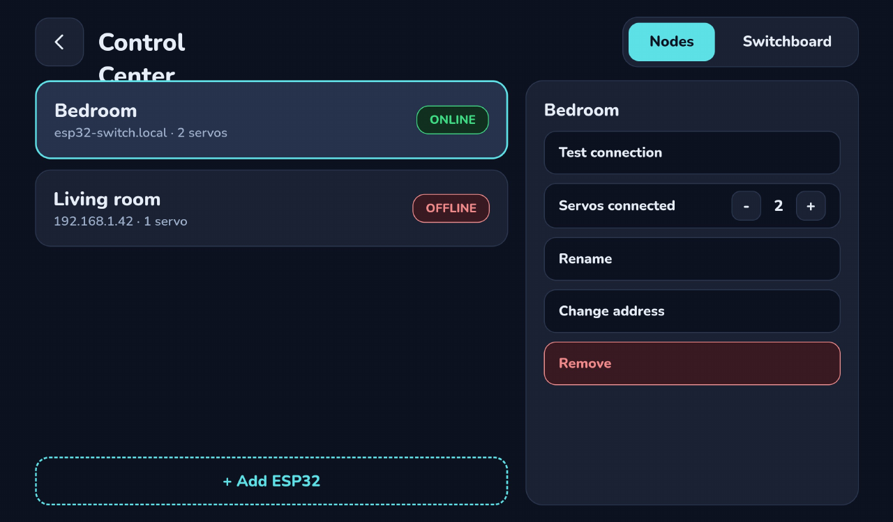 | **Control Center: switchboard** 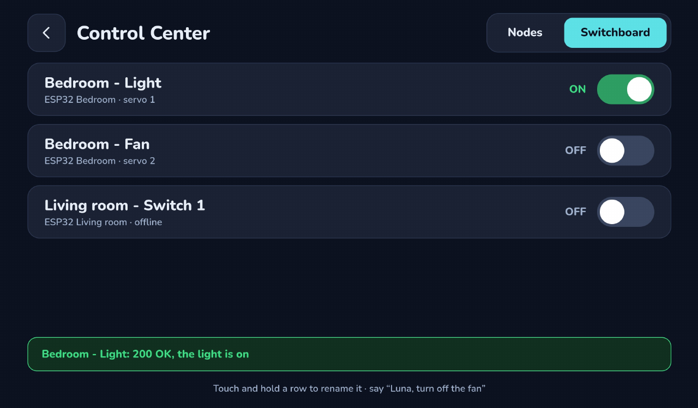 |

| Security and alerts |
|---|
| **Guard mode** 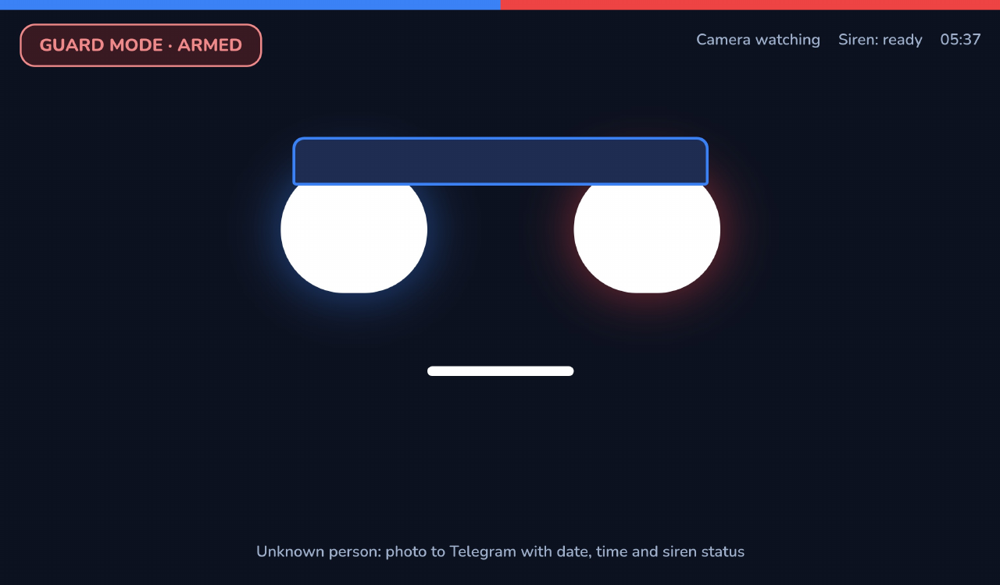 |
| **Telegram alerts** 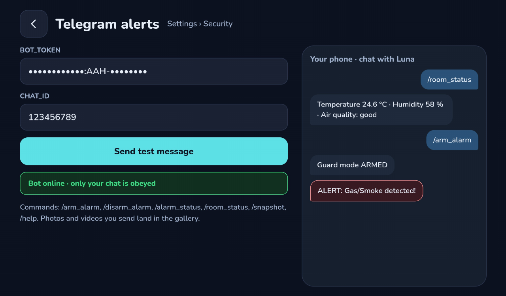 |
